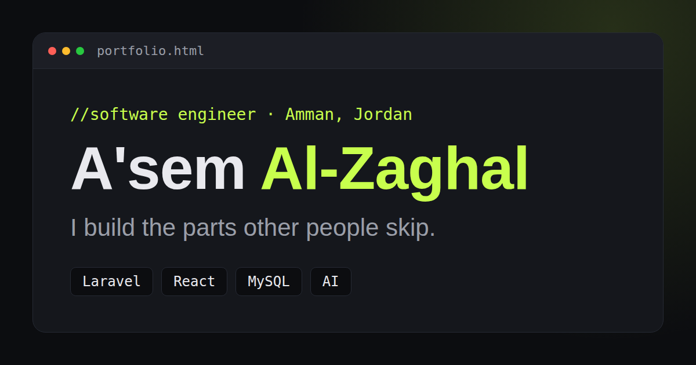

# A'sem Al-Zaghal | Portfolio



**Live site:** https://mrasemz.github.io/Asem_AlZaghal_Portfolio

My personal portfolio, built with plain HTML, CSS and JavaScript. No frameworks, no build step, no dependencies. Every section starts from one idea: show the work, not just describe it.

## Highlights

- **Break the code to enter:** the hero starts as a code editor. Click it and it shatters into 80 shards that fly away from the click point, revealing the real page.
- **Skill tree:** a game-style tree where a glowing dot walks through the pipes and unlocks each skill, then patrols the tree every few seconds. Branches collapse on click.
- **Journey map:** clickable pins along a route, built with radio inputs and no JavaScript.
- **Case studies:** each project card opens a slide-in panel (a native `<dialog>`) with the problem, approach, decisions and result.
- **Services:** expandable rows built on `<details>`, each linking to a project that proves it.
- **Contact:** the email types itself in on scroll, with copy buttons and a résumé download.
- **Details:** scroll progress line, back-to-top button, five accent colors that are remembered between visits, and a footer comment signature.
- **Accessible by default:** keyboard navigation, focus styles, semantic HTML and full support for `prefers-reduced-motion`.
- **Responsive:** designed for phones first, checked from 320px up.

## Tech

| Layer | What I used |
|---|---|
| Markup | Semantic HTML5, `<dialog>`, `<details>` |
| Styling | Modular CSS, custom properties (design tokens), `:has()`, `color-mix()`, `@property` |
| Behavior | Vanilla JavaScript as ES modules |
| Hosting | GitHub Pages |

## How it is organized

The rule I followed: **JavaScript decides when, CSS decides how.** JS only adds a class or sets a CSS variable, and CSS does all the animating.

```
portfolio/
├── index.html
├── favicon.svg, favicon.ico, apple-touch-icon.png
├── og-image.png              link preview image (1200 x 630)
├── docs/
│   └── Asem_AlZaghal_CV.pdf
├── design/
│   └── og-image.html         editable source of the preview image
└── code/
    ├── css/
    │   ├── main.css          only @imports, in order
    │   ├── tokens.css        colors, fonts, motion, accent themes
    │   ├── base.css          reset, typography, shared utilities
    │   ├── motion.css        keyframes, scroll reveal, reduced motion
    │   └── components/       one file per section or feature
    └── js/
        ├── main.js           starts every module
        ├── data/
        │   └── case-studies.js
        └── modules/          one file per feature
```

## Run it locally

The JavaScript uses ES modules, which browsers block when you open `index.html` by double-clicking. Use a local server instead:

- **VS Code:** install the *Live Server* extension, right-click `index.html`, then *Open with Live Server*.
- **Python:** `python -m http.server 8000`, then open `http://localhost:8000`.
- **Node:** `npx serve`.

## Make it yours

| To change | Edit |
|---|---|
| Case study text | `code/js/data/case-studies.js` |
| Skills in the tree | the `skillsTree` object in `code/js/modules/skills-tree.js` |
| Accent colors | the palette at the top of `code/css/tokens.css` |
| How violent the shatter is | the `FORCE` object in `code/js/modules/shatter.js` |
| Walking dot speed and patrol delay | the `WALK` object in `code/js/modules/skills-walker.js` |
| Résumé | replace `docs/Asem_AlZaghal_CV.pdf` |

Adding a new accent color takes three steps: add the color to the palette in `tokens.css`, add one `html[data-accent="..."]` rule below it, and add one swatch button in the footer of `index.html`.

## Browser support

Built for current versions of Chrome, Edge, Firefox and Safari. It uses modern CSS (`:has()`, `color-mix()`, `@property`) and the native `<dialog>` element. Older browsers still show all the content, but some effects may be missing.

## Deploy

The site is a folder of static files, so any static host works. For GitHub Pages: push the folder to a repository, open **Settings → Pages**, choose the `main` branch and the root folder, and save.

## Contact

- Email: alzaghal.asem@gmail.com
- LinkedIn: https://www.linkedin.com/in/asem-al-zaghal/
- GitHub: https://github.com/MrAsemZ
